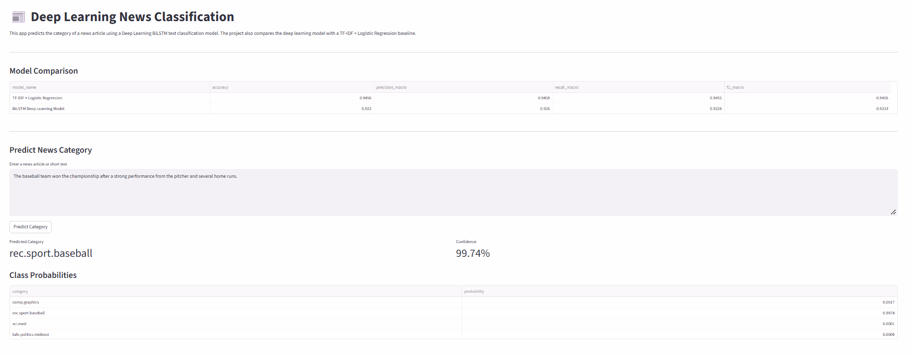
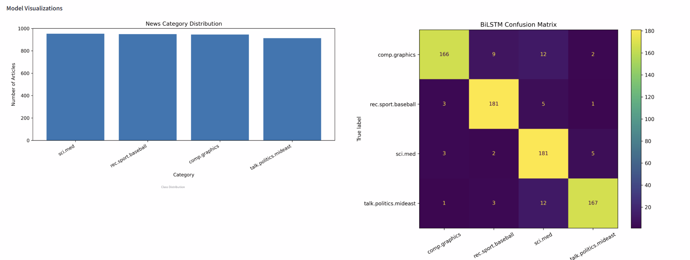
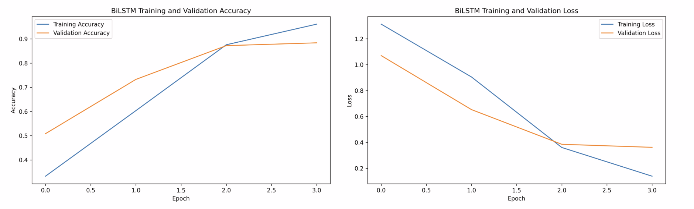
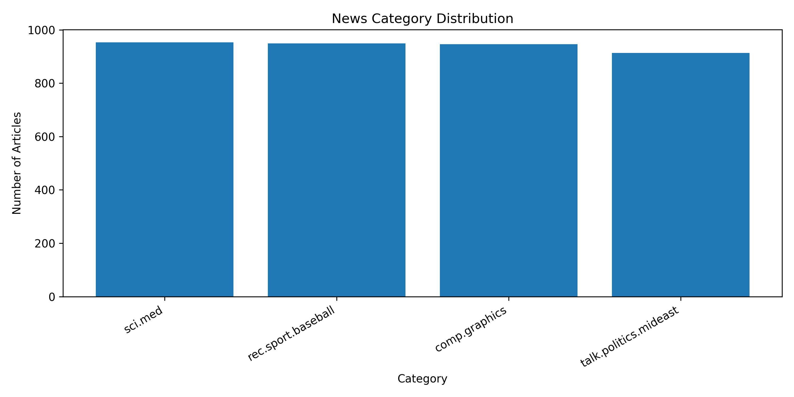
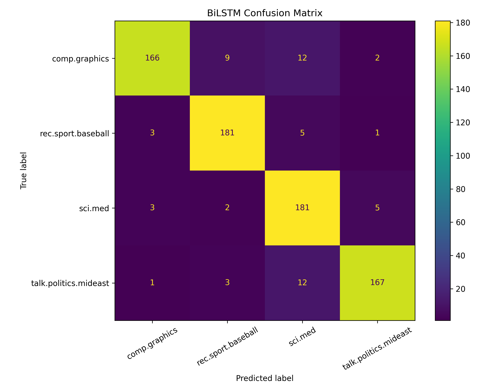
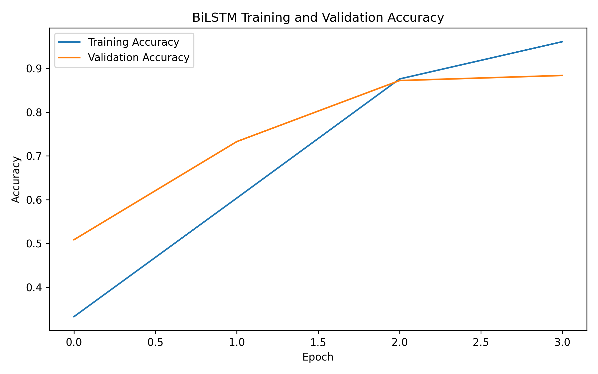
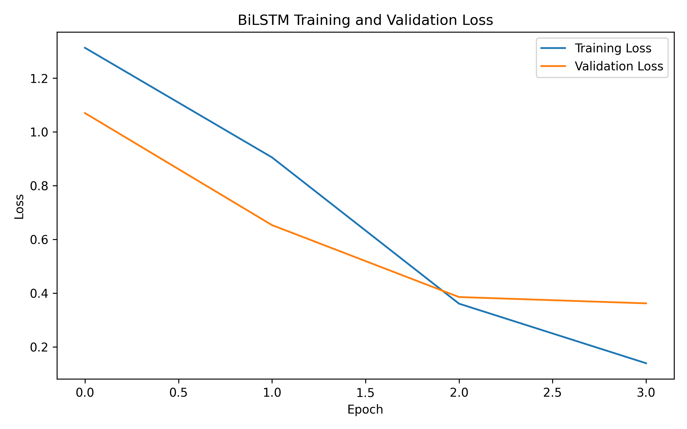

# Deep Learning News Classification

An end-to-end, four-class text classification project comparing a **TF-IDF + Logistic Regression** baseline with a **Bidirectional LSTM (BiLSTM)**. The evaluation pipeline uses **separate training, validation, and held-out test sets** to avoid using test labels for early stopping.

## Key results

On the latest reported run (25 November 2026), **TF-IDF + Logistic Regression outperformed BiLSTM** on the held-out test set:

| Model | Accuracy | Macro precision | Macro recall | Macro F1 |
|---|---:|---:|---:|---:|
| TF-IDF + Logistic Regression | **94.56%** | **94.58%** | **94.55%** | **94.56%** |
| BiLSTM | 92.30% | 92.60% | 92.28% | 92.33% |

These are results from a **random stratified split** of the selected `20 Newsgroups` texts after cleaning, **not** the dataset's original official train/test partition. They are specific to this experiment and are not claims of general-purpose news-classification performance. Stochastic deep learning results may vary across runs unless all random seeds and execution settings are controlled.

## Dataset

The project uses four categories from scikit-learn's **20 Newsgroups** dataset:

- `comp.graphics`
- `rec.sport.baseball`
- `sci.med`
- `talk.politics.mideast`

The loader requests the full selected-category dataset using `fetch_20newsgroups(subset="all", remove=("headers", "footers", "quotes"))`. It removes empty records and does **not** silently replace a failed download with a tiny synthetic dataset. The dataset may need an internet connection the first time it is fetched.

### Latest reported data split

| Stage | Documents |
|---|---:|
| Loaded | 3,792 |
| After cleaning and exact cleaned-text deduplication | 3,761 |
| Training | 2,406 (about 64%) |
| Validation | 602 (about 16%) |
| Held-out test | 753 (about 20%) |

The `TEST_SIZE=0.2` parameter applies to the whole dataset. `VALIDATION_SIZE=0.2` then applies to the remaining 80%, yielding an approximately **64/16/20** split. Both splits are stratified by class. Documents with identical **cleaned text** are removed before splitting, reducing—but not proving the absence of—all forms of near-duplicate leakage.

## Methodology

### 1. Text preparation

The preprocessing pipeline lowercases text, removes URLs and nonalphabetic characters, collapses whitespace, filters very short cleaned texts, and removes exact duplicates by cleaned text.

### 2. Independent data partitions

- **Train:** fits the TF-IDF vectorizer, Logistic Regression classifier, text tokenizer, label encoder, and BiLSTM weights.
- **Validation:** monitors BiLSTM `val_loss` for early stopping and selects the best weights; it is **never used as the test set**.
- **Test:** evaluates the final baseline and final BiLSTM only after model training; model comparisons are saved to CSV.

The baseline is a scikit-learn `Pipeline`, ensuring TF-IDF vocabulary and IDF statistics are fitted only on training text. The neural tokenizer is also fitted only on training text.

### 3. Baseline: TF-IDF + Logistic Regression

`TfidfVectorizer` uses up to 10,000 features, word unigrams/bigrams, and English stop-word filtering. A `LogisticRegression` classifier predicts the four categories.

### 4. Deep model: Embedding + BiLSTM

The Keras model uses an embedding layer, bidirectional LSTM, dropout, dense layers, and softmax output. It uses up to 10,000 vocabulary entries, padded sequences of length 200, embedding dimension 128, batch size 32, and a maximum of four epochs. `EarlyStopping` monitors validation loss with patience 2 and restores the best validation weights.

The output `results/classification_report.csv` is the **BiLSTM** test classification report. `results/metrics.csv` compares **both** models on the held-out test set.

## Run locally (Windows Command Prompt)

Tested by the project author using **Python 3.12** and **TensorFlow 2.21.0** on Windows, with CPU training.

```cmd
# Clone and enter repository
git clone https://github.com/Zahra-ziaee/deep-learning-news-classification.git
cd deep-learning-news-classification

# Create and activate a dedicated environment
py -3.12 -m venv .venv
.venv\Scripts\activate.bat

# Install dependencies
python -m pip install --upgrade pip
python -m pip install -r requirements.txt

# Run automated split/loader checks
python -m unittest discover -s tests -p "test_*.py" -v

# Download (if needed), train, evaluate and generate charts
python main.py

# Launch the prediction app
python -m streamlit run app/streamlit_app.py
```

**Note:** TensorFlow 2.11+ does not provide native-Windows CUDA GPU support. Training on native Windows is expected to use CPU; GPU setups typically require WSL2 or a different supported environment. If dependencies were already installed, avoid reinstalling them needlessly—first run `python -m pip check`.

## Project structure

```text
deep-learning-news-classification/
|-- app/
|   `-- streamlit_app.py
|-- src/
|   |-- config.py
|   |-- data_loader.py
|   |-- preprocessing.py
|   |-- baseline_model.py
|   |-- deep_model.py
|   |-- evaluation.py
|   |-- predict.py
|   `-- visualization.py
|-- tests/
|   `-- test_data_split.py
|-- data/                   # Generated content excluded from git
|-- models/                 # Generated artifacts excluded from git
|-- results/
|   |-- metrics.csv
|   |-- classification_report.csv
|   `-- figures/
|-- screenshots/
|-- main.py
|-- requirements.txt
`-- README.md
```

## Generated outputs

| Path | Description |
|---|---|
| `results/metrics.csv` | Held-out test accuracy, macro precision, recall, and F1 for both models |
| `results/classification_report.csv` | Per-class test classification report for BiLSTM |
| `results/figures/class_distribution.png` | Class counts after preprocessing |
| `results/figures/confusion_matrix.png` | BiLSTM test confusion matrix |
| `results/figures/training_accuracy.png` | Train vs validation accuracy by epoch |
| `results/figures/training_loss.png` | Train vs validation loss by epoch |
| `models/baseline_tfidf_logistic_model.joblib` | Trained TF-IDF + Logistic Regression pipeline |
| `models/news_bilstm_model.keras` | Trained BiLSTM |
| `models/tokenizer.joblib` | Fitted training-text tokenizer |
| `models/label_encoder.joblib` | Fitted training-label encoder |

`data/` and `models/` are ignored by git; generating them requires running the pipeline. The chart files and metric CSVs are regenerated when `python main.py` completes.

## Dashboard and visualizations

The Streamlit app uses the fitted **BiLSTM** for user-entered text classification and displays model-comparison metrics and saved figures. The displayed softmax "confidence" is **not a calibrated reliability guarantee**.

### Prediction demo



### Model visualizations



### Training curves



*Screenshots captured from the updated Streamlit dashboard after retraining on the independent train/validation/test split (25 November 2026). The shown example prediction is a demo; the displayed softmax score is not a calibrated confidence guarantee.*

### Generated evaluation plots









## Quality checks and limitations

- **Automated tests:** four tests cover stratified, nonoverlapping data partitions; exact cleaned-text duplicate removal; handling of inadequate sample sizes; and an explicit error for dataset download failure. These checks passed in the latest reported run.
- **Held-out evaluation:** test labels are not supplied to the neural network during training or early stopping.
- **Remaining data risks:** the 20 Newsgroups dataset may contain semantically similar or related posts beyond exact duplicates. Random splits do not establish out-of-time or out-of-domain generalization.
- **No extensive tuning:** results are for the stated baseline and BiLSTM configurations; no exhaustive hyperparameter search or uncertainty interval is reported.
- **Reproducibility:** the scikit-learn split uses a fixed random state. Keras/TensorFlow weight initialization and training may still vary across runs.
- **Deployment:** the app is a local demonstration. Input handling, performance testing, model monitoring and probability calibration would need additional work for production use.
- **Versioning:** `requirements.txt` pins top-level packages from the provided environment snapshot, not a fully locked transitive dependency graph.

## Interview / résumé summary

> Developed a four-class NLP classification pipeline comparing TF-IDF + Logistic Regression with a BiLSTM neural network. Corrected validation leakage by separating train, validation, and held-out test data; fitted preprocessing on training text only; and added automated split checks. On 753 held-out documents, achieved **94.56% accuracy / 94.56% macro F1** with Logistic Regression and **92.30% accuracy / 92.33% macro F1** with BiLSTM, highlighting the importance of strong classical baselines.

## Author

**Zahra Ziaee** · [GitHub](https://github.com/Zahra-ziaee)
